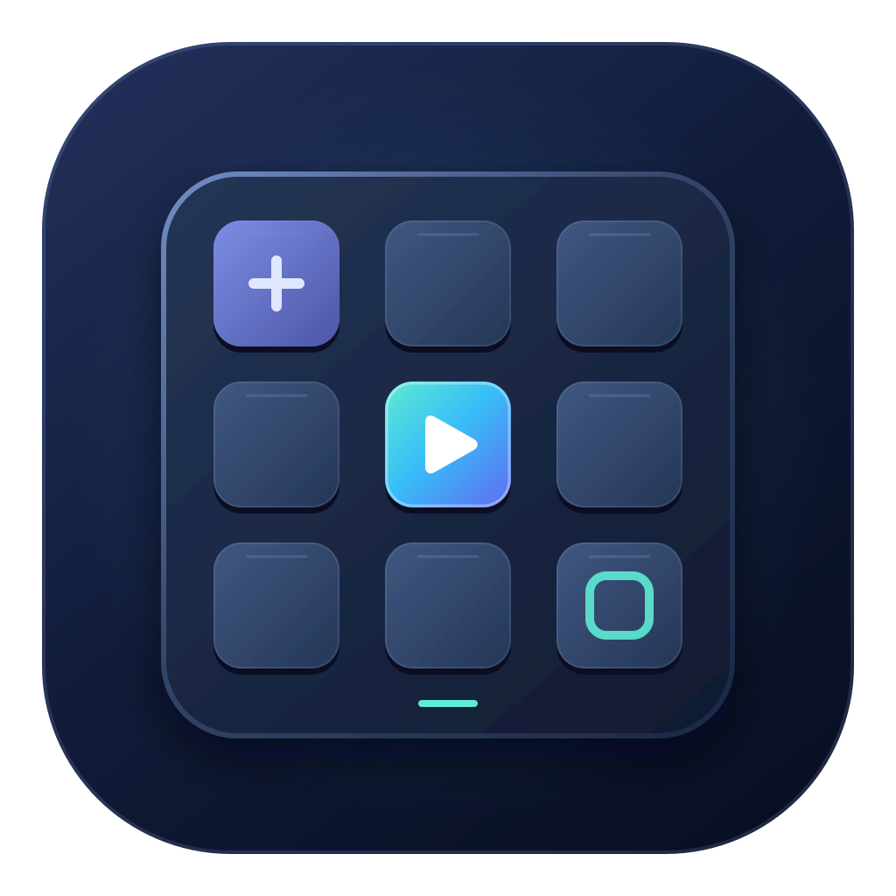

# go-deck

<p align="center"></p>

[English](README.md) · **Português**

[](LICENSE)
[](https://github.com/mariombn/go-deck/releases/latest)
[](https://github.com/mariombn/go-deck/actions/workflows/release.yml)
[](#instala%C3%A7%C3%A3o)
[](https://github.com/mariombn/go-deck/stargazers)

Um *Stream Deck* open-source: um app desktop (**Windows, macOS e Linux**) que expõe
**vários grids** de botões na rede local. Pelo celular, via QR Code, você abre os
grids no navegador e, ao tocar num botão, o computador executa a ação configurada —
desde uma **macro de teclado** até abrir um programa, uma URL, controlar o
**OBS Studio** ou mutar o **Discord**.

Sem hardware extra. Seu celular vira o deck.

<!-- TODO: adicionar um screenshot do editor desktop e um GIF curto de "toque no celular -> ação no PC".
     Coloque os arquivos em docs/ e referencie aqui, ex.:
     
     
     É a adição de maior impacto para novos usuários — adicione antes de divulgar. -->

---

## Instalação

> Não precisa instalar Go, Node nem compilar nada. Baixe o app pronto:

**➡️ [Baixe a última versão](https://github.com/mariombn/go-deck/releases/latest)**

### Windows

1. Baixe o `go-deck.exe`.
2. Ao abrir, o Windows pode mostrar *"O Windows protegeu o seu PC"* (porque o app
   ainda não é assinado). Clique em **Mais informações → Executar assim mesmo**.
3. Uma janela com o editor e o QR Code vai abrir.

### Linux

Baixe **AppImage**, **`.deb`** ou **`.rpm`** (x86_64) nos releases. Os pacotes
nativos instalam lançador, ícones e regras USB; o AppImage usa GTK3/WebKitGTK 4.1
do sistema. Veja [instalação e formatos](docs/releases.md) e
[permissões/uso do hardware](docs/linux.md).
Para compilar, o binário é `build/bin/go-deck`; atalhos funcionam em Wayland e X11.

### Rise Mode Vision 2

O app desktop controla o Vision 2 por USB no Windows, macOS e Linux. Feche
outros controladores do Vision 2 antes de ativar **Controlar USB**. Veja
[como conectar e testar o hardware](docs/vision2.md).

### macOS

1. Abra o `go-deck-macos.dmg` e arraste `go-deck.app` para Aplicativos. Nas versões
   até a `v0.2`, extraia o `go-deck-macos.zip` primeiro.
2. Abra o app em Aplicativos. Se o macOS bloquear a abertura porque o app ainda
   não é notarizado, siga [as instruções da Apple](https://support.apple.com/pt-br/102445).
3. O app vai pedir permissão de **Acessibilidade** (necessária para simular o
   teclado). Aprove em *Ajustes do Sistema → Privacidade e Segurança → Acessibilidade*.

### Requisitos

- **Windows 10/11** (o WebView2 já vem no Windows 11).
- **macOS** (versão recente).
- **Linux** com GTK3/WebKitGTK; `uinput` para atalhos e `hidraw` para o Vision 2.
- Celular e PC na **mesma rede Wi-Fi**.

> **Atenção à segurança:** o go-deck não tem autenticação. Qualquer um na mesma
> rede Wi-Fi que abrir a URL pode acionar os botões que você já configurou. Use na
> sua rede doméstica/confiável — não em Wi-Fi público. Veja
> [Segurança e limitações conhecidas](#seguran%C3%A7a-e-limita%C3%A7%C3%B5es-conhecidas).

---

## Uso

1. Abra o `go-deck.exe` / `go-deck.app`.
2. Crie/renomeie **grids** nas abas laterais e defina o tamanho (linhas × colunas)
   de cada um. Clique numa célula para criar um botão: rótulo, **tipo de ação** e
   **aparência** (emoji/imagem/cor). Clique em **Salvar configuração**.
3. No celular (mesma rede Wi-Fi), escaneie o QR Code.
4. Toque num botão → a ação é executada no PC (ou, se for *navigate*, troca de grid
   no próprio celular). O botão **Home** fixo volta ao primeiro grid.

A configuração é salva em:

- **Windows:** `%APPDATA%/DeckPilot/config.json`
- **macOS:** `~/Library/Application Support/DeckPilot/config.json`
- **Linux:** `${XDG_CONFIG_HOME:-~/.config}/DeckPilot/config.json`

### Ações disponíveis

| Tipo | O que faz |
|------|-----------|
| **keypress** | Combo ou sequência ordenada de combinações, com captura física e teclado virtual. |
| **mouse** | Clique, clique duplo, movimento relativo e rolagem; também funciona em sequências. |
| **launch** | Abre um programa (`path` + `args`), via `os/exec` sem shell. |
| **url** | Abre uma URL no aplicativo padrão do SO. |
| **obs** | Controla o OBS: trocar cena, gravar/transmitir, mutar fonte, disparar hotkey. |
| **discord** | Mute/Deafen — na prática um *keypress* do keybind global do Discord. |
| **sequence** | Executa uma lista de ações em ordem (aborta no 1º erro). |
| **navigate** | Vai para outro grid — resolvido **no celular**, não toca o PC. |

### Integrações

- **OBS Studio:** habilite *Ferramentas → Configurações do Servidor WebSocket* no
  OBS, e preencha host/porta/senha no painel lateral do editor (com **Testar
  conexão**). A conexão é feita por toque (sem estado), via obs-websocket v5.
- **Discord:** não há API local para controlar o próprio cliente. Configure o atalho
  desejado como **keybind global** no Discord e capture a mesma tecla no go-deck. Por
  isso só *mute/deafen* (push-to-talk é "segurar", não casa com toque).

### Vários grids e navegação

Cada grid é uma página com tamanho e botões próprios. Um botão *navigate* leva a
outro grid (troca client-side, sem enviar nada ao PC); o celular tem um botão
**Home** fixo para voltar ao primeiro.

### Aparência dos botões

Cada botão pode ter cor de fundo (paleta ou cor livre; o texto ganha contraste
automático) e um ícone — **emoji** (seletor com busca) **ou imagem** (enviada e
redimensionada para 128 px, embutida na config como data URL).

### Modelo de teclas

- Modificadores: `ctrl`, `shift`, `alt`, `win` — mais `cmd`, `opt` (exclusivos macOS)
- Letras `a`–`z`, dígitos `0`–`9`, `f1`–`f12`
- Especiais: `enter`, `esc`, `tab`, `space`, `backspace`, `delete`, `insert`,
  `home`, `end`, `pageup`, `pagedown`, setas (`up`/`down`/`left`/`right`)
- Mídia: `mute`, `volup`, `voldown` — mais `playpause`, `nexttrack`, `prevtrack` (Windows e Linux)
- Um botão = **um combo simultâneo** (ex.: `["ctrl","shift","m"]` ou `["cmd","c"]` no Mac).

---

## Segurança e limitações conhecidas

Este é um projeto em estágio inicial (postura POC). Conheça os trade-offs:

- **Sem autenticação/HTTPS:** qualquer dispositivo na LAN que abrir a URL pode
  acionar os botões **já configurados**. Há validação de `Origin` no WebSocket
  (higiene mínima) e um token de pareamento na URL do QR, mas **não é seguro para
  redes não confiáveis**. Com a ação **launch**, isso significa que a LAN pode
  disparar a abertura dos programas/URLs definidos no PC (o celular só envia o *id*
  do botão, nunca um `path`). A **senha do OBS** fica no `config.json` em
  **texto puro**.
- A **porta** é lida na inicialização. Mudá-la no editor exige reiniciar o app
  (porta ocupada gera erro explícito, sem fallback automático).
- `Ctrl+Alt+Del` e a tecla Win em combo não são capturáveis pelo navegador (o SO os
  intercepta); use os botões de teclas especiais para Win/mídia.
- **Linux:** atalhos exigem acesso a `/dev/uinput`; o Vision 2 exige acesso ao
  `hidraw` USB e OpenDeck fechado. Veja [permissões](docs/linux.md).
- **macOS:** ações `keypress` exigem permissão de **Acessibilidade**. Teclas de mídia
  `playpause`/`nexttrack`/`prevtrack` não são suportadas no macOS.
- O app macOS não é assinado/notarizado — para abrir pela primeira vez: clique direito → Abrir.

---

## Melhorias do editor

Há rótulo oculto (mantém o nome para organização), prévia com texto limitado,
arraste de botões com troca automática no destino ocupado, seletores escuros
compatíveis com WebKitGTK e teclado virtual ao lado de Capturar.
Veja [teclado, mouse e organização dos botões](docs/editor-e-input.md).

## Contribuindo

Contribuições são muito bem-vindas! Alguns ótimos pontos de entrada:

- **🐧 Linux e hardware USB** — ampliar testes em distribuições/compositores e
  adicionar novos aparelhos usando `internal/vision2` como referência.
- **Nova Action ou integração** — graças ao `ExecContext`, adicionar uma capacidade
  é um campo novo, sem refatorar o resto. Veja `internal/action/`.
- **Melhorias de UX e correções de bugs** são sempre bem-vindas.

Veja [docs/kanban.md](docs/kanban.md) para o que está planejado.

> **Nota:** o código e os comentários do projeto são escritos em **pt-BR**. PRs em
> inglês são aceitos, mas mantenha os comentários de código em pt-BR para ficar
> consistente com o restante do código.

### Ambiente de desenvolvimento

Pré-requisitos:

- **Go 1.23+**
- **Node.js LTS**
- **Wails CLI v2:** `go install github.com/wailsapp/wails/v2/cmd/wails@latest`
- **Windows:** WebView2 runtime (já vem no Windows 11). Para compilar com suporte ao
  Vision 2, instale o GCC do MinGW-w64 e defina `$env:CGO_ENABLED = '1'` no PowerShell.
- **macOS:** Xcode Command Line Tools (`xcode-select --install`) para simular teclado e acessar o Vision 2 por USB.
- **Linux:** GTK3/WebKitGTK e compilador C; veja [docs/linux.md](docs/linux.md).

Rodar em desenvolvimento (hot-reload):

```bash
wails dev
```

Abre a janela desktop com hot-reload. Em dev, o servidor de rede faz reverse-proxy
para o Vite (porta 5173), então o celular recebe a mesma versão. O endereço de acesso
do celular aparece no QR Code da própria UI.

Build de produção:

```bash
wails build
```

Gera o app com o React embutido:

- **Windows:** `build/bin/go-deck.exe`
- **macOS:** `build/bin/go-deck.app`
- **Linux:** `build/bin/go-deck` (use `bash scripts/build-linux.sh`)

---

## Como funciona

```
Toque no celular ──ws──► servidor Go ──► executa a Action:
                                          • keypress  (SendInput/Win32 ou CGEvent/macOS)
                                          • launch / url (os/exec, sem shell)
                                          • obs       (obs-websocket v5)
                                          • discord   (keybind global)
                                          • sequence  (várias em ordem)
                            └─ navigate é resolvido no próprio celular (troca de grid)
```

- **Desktop (Wails):** editor de configuração + QR Code. Webview NÃO exposto na rede.
- **Servidor de rede (net/http + gorilla/websocket):** processo separado, no mesmo
  binário, serve o app React ao celular e recebe os toques via WebSocket.
- **Camadas isoladas por interface:** `InputController` (teclado — Windows via
  `SendInput` em Go puro, macOS via `CGEvent` com CGO), `Launcher` (abre
  programas/URLs — Windows usa `rundll32`, macOS usa `open`) e `obs.Controller`
  (OBS via obs-websocket, plataforma-agnóstico). As ações recebem um `ExecContext`
  com essas capacidades, então adicionar uma nova = um campo a mais, sem refatorar
  o resto.
- **Um único bundle React:** detecta em runtime se está no Wails (mostra o editor) ou
  no navegador do celular (mostra só os grids).

Inspirado no [OpenDeck](https://github.com/nekename/OpenDeck). Construído com
**Go + Wails v2 + React/TypeScript + Tailwind**.

### Pegadinhas de implementação (Windows + Wails v2)

Duas armadilhas que custam horas de debug e já estão tratadas no código:

1. **`crossorigin` no `<script type="module">`** — o Vite adiciona esse atributo
   por padrão. Sob o esquema interno do Wails (`wails.localhost`), o WebView2 pode
   bloquear o módulo como CORS (sem header `Access-Control-Allow-Origin`),
   resultando num **webview totalmente em branco** (só a cor de fundo). Removido
   via plugin no [vite.config.ts](frontend/vite.config.ts).
2. **Slice `nil` vira `null` no JSON** — em Go, `append([]T(nil))` com zero
   elementos retorna `nil`, que serializa como `null` (não `[]`). Um deck sem
   botões enviava `"buttons": null`, e o frontend quebrava em `.find()`. O `clone()`
   do config força `[]T{}`; o frontend ainda tem guardas defensivas.

### Estrutura

```
go-deck/
├── main.go                 # bootstrap Wails + embed do frontend
├── app.go                  # bindings expostos ao desktop (config, rede, QR, TestOBS)
├── internal/
│   ├── config/             # modelo de dados (Pages/Button/Integrations) + load/save
│   ├── input/              # InputController — SendInput (Windows) / CGEvent (macOS)
│   ├── launch/             # Launcher (abre programas/URLs, sem shell) — por SO
│   ├── obs/                # obs.Controller via obs-websocket v5 (lib goobs)
│   ├── action/             # interface Action + tipos (keypress/launch/url/obs/…)
│   └── server/             # http + websocket + QR + detecção de IP da LAN
└── frontend/src/
    ├── components/         # DeckGrid, DeckButton (compartilhados)
    ├── desktop/            # editor: abas de grids, ButtonEditor, ActionFields,
    │                       #   AppearanceFields (emoji/imagem/cor), OBSPanel
    ├── mobile/             # grids + WebSocket + navegação/Home (modo celular)
    ├── lib/                # runtime, teclas, resumo de ação, aparência/contraste
    └── types.ts            # tipos compartilhados (DeckConfig, Page, Action…)
```

---

## Licença

[MIT](LICENSE) © Mario de Moraes
